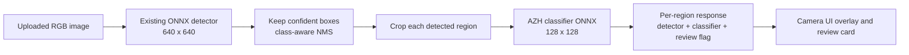

# Two-model wound analysis integration plan

## Goal

Combine the current website detector with the existing AZH six-class classifier without replacing the detector, inventing clinical mappings, or presenting either model as a diagnosis.

The intended pipeline is:



## Current state

The website currently uses:

- `server/models/diabetes-wound-detector.onnx`
- `server/woundInference.ts`
- protected tRPC mutation `wound.infer`
- `client/src/pages/DiagnosticCamera.tsx`

The detector returns five labels:

- `callus_corn`
- `dfu_ulcer`
- `infected_wound`
- `necrotic_wound`
- `normal_foot`

The existing AZH classifier is a separate PyTorch checkpoint. It returns six source-native labels:

| Code | Display name |
| --- | --- |
| `BG` | Background |
| `N` | Normal skin |
| `D` | Diabetic wound |
| `P` | Pressure wound |
| `S` | Surgical wound |
| `V` | Venous wound |

The classifier currently has source-split test accuracy around 50.4% and macro F1 around 43.6%. These results are not patient-leakage-safe because the source archives lack reliable patient or wound grouping IDs.

## Non-goals

This integration must not:

- replace the current detector immediately;
- convert `dfu_ulcer` into `D` automatically;
- treat `infected_wound` or `necrotic_wound` as AZH wound classes;
- turn image-level classification labels into boxes or masks;
- create a clinical diagnosis, severity score, treatment plan, or healing prediction;
- log raw images, patient identifiers, or clinical text in model telemetry;
- deploy to production without explicit review and confirmation.

## Phase 0: model packaging and compatibility gate

### 0.1 Export the old classifier to ONNX

Add a dedicated export command, for example:

```bash
python scripts/export_azh_classifier.py \
  --checkpoint /private-data/prototype-20261009-classification-continued/best.pt \
  --output server/models/azh-classifier.onnx \
  --metadata server/models/azh-classifier.labels.json
```

The export must record:

- checkpoint SHA-256;
- ONNX SHA-256;
- PyTorch version;
- ONNX opset;
- input shape `[1, 3, 128, 128]`;
- RGB channel order;
- normalization `pixel / 255`;
- class order and human-readable label map;
- training run identifier;
- source split warning;
- `patient_group_id_available: false`;
- `clinical_use: false`.

Use dynamic batch size only if the ONNX runtime test proves it is stable. A fixed batch of one is acceptable for the first integration.

### 0.2 Prove PyTorch/ONNX parity

For a fixed set of redacted fixture images, compare PyTorch and ONNX logits and probabilities. Fail the export if:

- output class order changes;
- probabilities contain NaN or infinity;
- maximum absolute difference exceeds the chosen tolerance;
- the checkpoint label map is missing or incomplete.

The website must not load a `.pt` file directly. It should load only the reviewed ONNX artifact and adjacent metadata.

### 0.3 Validate detector-crop compatibility

The AZH classifier was trained on the AZH image distribution. Before using detector crops, run an offline compatibility test:

1. run the detector on the AZH images;
2. crop the detector regions;
3. compare classifier performance on full images versus detector crops;
4. inspect crop size, padding, background, and class balance;
5. check whether normal/background regions are represented correctly.

If crop performance collapses, do not silently integrate it. Retrain the classifier on detector-style crops or keep the classifier as a separate image-level experiment.

## Phase 1: server inference pipeline

### 1.1 Add the classifier artifact

Add these reviewed files only after the export and parity gates pass:

```text
server/models/azh-classifier.onnx
server/models/azh-classifier.labels.json
```

Do not commit raw datasets, ZIP archives, patient identifiers, or private artifact URLs.

### 1.2 Separate classifier code from detector code

Create `server/woundClassification.ts` rather than putting all logic into the existing detector decoder. It should:

- lazily load and cache one ONNX classifier session;
- validate the metadata class order;
- preprocess RGB crops exactly like training;
- run softmax over six logits;
- return all probabilities and the top class;
- return an explicit unavailable/error status when the classifier cannot run.

Keep `server/woundInference.ts` responsible for detector preprocessing and box decoding. Refactor it only enough to expose the 640×640 preprocessed RGB buffer and kept boxes to the classifier stage.

### 1.3 Preserve the existing response contract

Keep the existing fields so the current UI does not break:

```ts
type InferenceResult = {
  model: "diabetes-wound-detector";
  task: "detect+classify";
  disclaimer: "Model suggestion only; clinician review required.";
  detections: Detection[];
  topSuggestion: Detection | null;
  regions: RegionAnalysis[];
};

type RegionAnalysis = {
  detection: Detection;
  classification:
    | {
        status: "ok";
        code: "BG" | "N" | "D" | "P" | "S" | "V";
        name: string;
        confidence: number;
        probabilities: Record<string, number>;
        model: "azh-classifier";
      }
    | {
        status: "unavailable" | "error";
        reason: string;
        model: "azh-classifier";
      };
  reviewRequired: true;
};
```

Example:

```json
{
  "model": "diabetes-wound-detector",
  "task": "detect+classify",
  "topSuggestion": {
    "label": "dfu_ulcer",
    "confidence": 0.81,
    "box": { "x": 142, "y": 96, "width": 218, "height": 174 }
  },
  "regions": [
    {
      "detection": {
        "label": "dfu_ulcer",
        "confidence": 0.81,
        "box": { "x": 142, "y": 96, "width": 218, "height": 174 }
      },
      "classification": {
        "status": "ok",
        "code": "D",
        "name": "Diabetic wound",
        "confidence": 0.67,
        "probabilities": {
          "BG": 0.03,
          "N": 0.04,
          "D": 0.67,
          "P": 0.12,
          "S": 0.05,
          "V": 0.09
        },
        "model": "azh-classifier"
      },
      "reviewRequired": true
    }
  ],
  "disclaimer": "Model suggestion only; clinician review required."
}
```

### 1.4 Crop and inference rules

For each kept detector box:

1. convert the detector-space box to the same 640×640 preprocessed image;
2. clamp the crop to image bounds;
3. reject zero-area or extremely small crops;
4. resize to 128×128 with the classifier's documented interpolation;
5. convert to RGB and divide pixels by 255;
6. classify without modifying the detector label;
7. attach the classifier result to that region;
8. cap work per request to the existing maximum detection count or batch crops when supported.

Do not run the classifier on the entire image as a hidden fallback. If no detector region exists, return no region classification and explain that the detector found no qualifying region.

A classifier failure should not erase a valid detector result. Return `status: "unavailable"` or `status: "error"` per region and keep the detector response usable.

## Phase 2: frontend review experience

Update `client/src/pages/DiagnosticCamera.tsx` in a backward-compatible way.

### UI behavior

- Keep the existing detector bounding-box overlay.
- Label the overlay as **Detector suggestion**.
- Add a separate result card for each detected region:
  - detector label and confidence;
  - AZH code and human-readable name;
  - classifier confidence;
  - optional probability list;
  - visible **Review required** state.
- Show a clear `not directly comparable` note when the detector and classifier labels do not describe the same taxonomy.
- Show an explicit unavailable state when classifier inference fails.
- Never render a combined phrase such as “infected diabetic wound” unless a future clinical taxonomy explicitly defines that relationship.

### Accessibility

- Provide accessible text for every detection box.
- Do not rely on box color alone to distinguish detector and classifier output.
- Keep keyboard focus order stable when regions appear.
- Announce new inference results through a status region.
- Keep the disclaimer visible near the result, not only in a tooltip.

### Saving behavior

The first version should save the image through the existing governed media workflow but should not write model predictions into clinical assessment fields automatically. If model output is later stored, add a versioned, audit-only JSON field with:

- model versions and hashes;
- inference timestamp;
- input hash;
- detector results;
- classifier results;
- explicit review status.

A clinician must be able to correct or reject the model suggestion.

## Phase 3: tests and validation

### Server tests

Extend `server/woundInference.test.ts` with:

- detector-only backward compatibility;
- one detection with successful classification;
- multiple detections with one classification per box;
- no detections returns an empty `regions` array;
- classifier failure preserves detector output;
- class probabilities sum to approximately 1;
- label map and code order match the metadata file;
- crop bounds never escape the 640×640 image;
- low-confidence detections do not trigger classifier work.

Use deterministic fixtures. Do not put protected patient images into the repository.

### Frontend tests

Add tests for:

- separate detector and classifier labels;
- human-readable AZH names;
- unavailable/error states;
- no-detection state;
- multiple region cards;
- visible disclaimer and keyboard-accessible result content.

### Build checks

Run before any deployment proposal:

```bash
pnpm check
pnpm test
pnpm build
```

Also run the PyTorch/ONNX parity test and the detector-crop compatibility evaluation.

## Phase 4: rollout and rollback

Use a feature flag such as:

```text
ENABLE_AZH_CLASSIFIER=false
```

Rollout sequence:

1. export and parity-test the classifier;
2. run server inference in disabled UI or shadow mode on approved test fixtures;
3. compare latency, failure rate, and output schema;
4. conduct clinical and privacy review;
5. enable the classifier for a small internal reviewer group;
6. collect only redacted technical telemetry;
7. expand only after review approves the results.

Rollback must be one configuration change: disable the AZH classifier and return the current detector-only response. The existing detector must remain untouched during the first rollout.

## Acceptance criteria

The integration is ready for an internal prototype review when:

- the current detector output remains backward-compatible;
- the classifier ONNX output matches the PyTorch checkpoint within tolerance;
- every region has separate detector and classifier fields;
- no detector label is silently converted into an AZH label;
- classifier failures do not break detector inference;
- the UI exposes confidence, taxonomy, and review-required status;
- all tests and builds pass;
- model hashes and source provenance are recorded;
- the patient-leakage limitation is shown in the model metadata and documentation.

It is **not** ready for clinical deployment until patient-grouped evaluation, external validation, calibration, bias analysis, human factors review, and an approved clinical safety process are complete.

## Implementation order

1. Export the existing classifier to ONNX.
2. Run PyTorch/ONNX parity checks.
3. Run detector-crop compatibility evaluation.
4. Add the classifier metadata and server session.
5. Extend `wound.infer` while preserving old fields.
6. Add server contract tests.
7. Update the camera UI with separate outputs.
8. Add frontend accessibility and error-state tests.
9. Run `pnpm check`, `pnpm test`, and `pnpm build`.
10. Review internally before any deployment or production model replacement.
